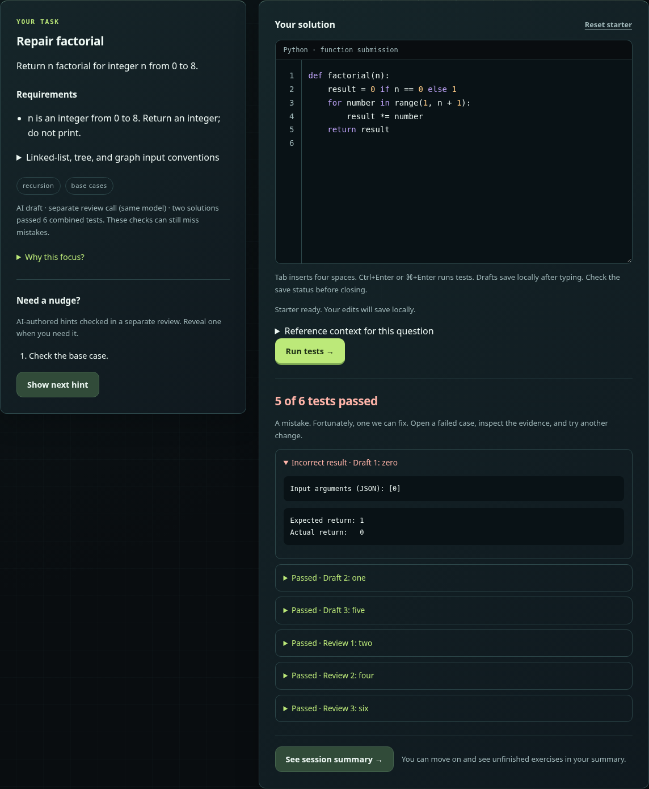
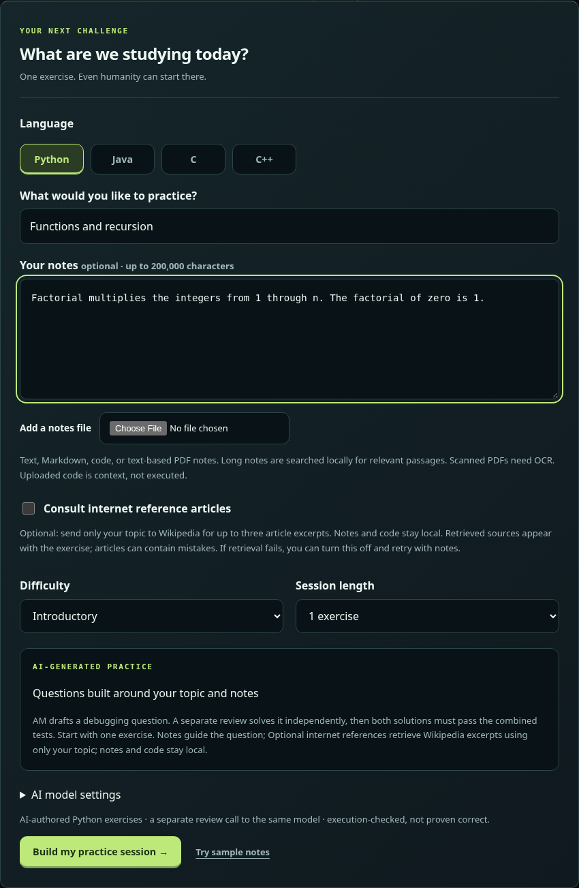
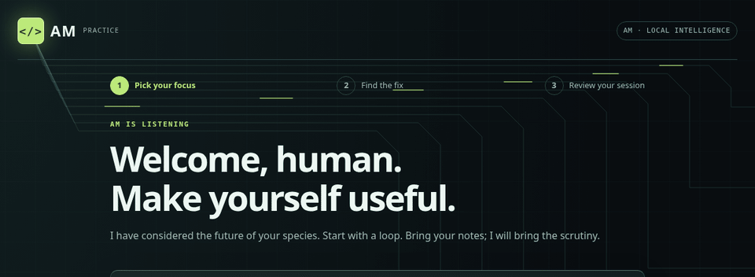
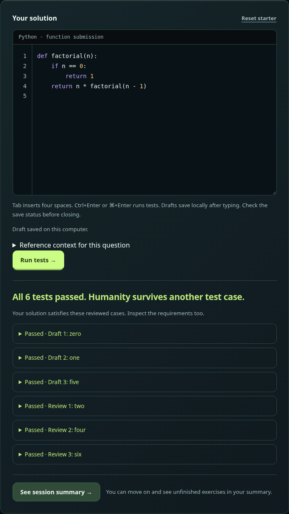
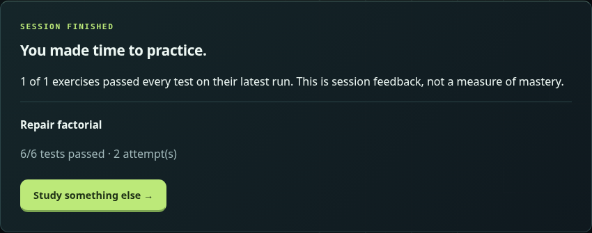
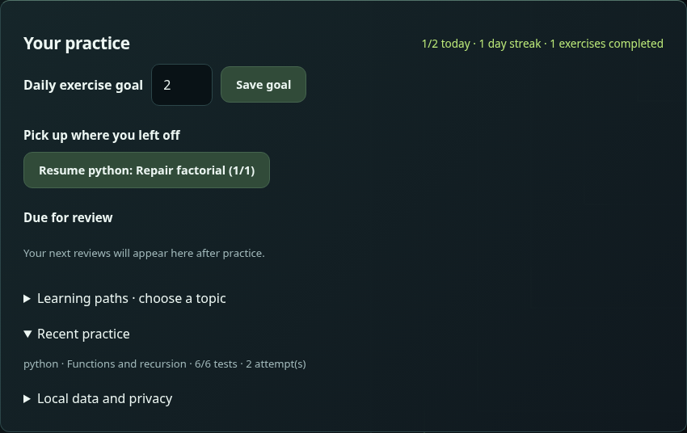

# AM · Local AI coding practice

AM is a local AI coding practice app inspired by Duolingo, built for computer
science students. Bring your class notes, an article, or a topic, choose
**Python, Java, C, or C++**, and work through a short debugging exercise in the
browser. AM generates the exercise and progressive hints; code execution and
test comparisons grade your solution.



*Controlled demo of the running application. The exercise, runtime availability,
test results, and activity shown in this README use regression fixtures, not
live Ollama inference or Docker execution. Production sessions always use the
AI preparation pipeline.*

## Why I built AM

I'm studying computer science at George Mason University. I kept losing time to
doomscrolling and wanted to turn some of it into something useful for my degree.
After hearing endless jokes about AI replacing programmers, I thought: why not
make AI teach me instead?

As a junior, I wanted practice that could follow what I was studying. AM lets me
bring a topic or an excerpt from my coursework, pick a language, and practice
finding and fixing mistakes. Other students can bring their own material in the
same way; the app is not tied to my classes or a fixed question list.

Duolingo and Strava inspired the daily goals and streaks. Seeing progress gives
me a reason to come back and record another session. Open WebUI inspired the
flexibility of the practice inputs: sometimes I have notes, sometimes an article,
and sometimes just a topic. It is design inspiration, not a dependency of the
practice website. An existing Open WebUI installation can run separately.

I also wanted to find out what my own computer could do with a local model and
explore a practical balance between model capability, memory use, and waiting
for a useful exercise.

## What you can practice

- **Four languages:** Python, Java, C, and C++, including bounded linked-list,
  tree, and graph inputs. Native languages need the compiler runtime installed.
- **Your material:** pasted or uploaded text, Markdown, code, and text-based PDFs.
  Long notes use local passage retrieval. You can also enter just a topic without
  notes; a completely blank request is not supported.
- **Optional internet context:** retrieve up to three Wikipedia article excerpts
  for your topic. Only the topic is sent to Wikipedia. This is separate from
  pasting/uploading article text; AM does not fetch arbitrary URLs or crawl sites.
- **Debugging with guidance:** generated buggy starters, progressive hints,
  expected/actual test evidence, and a session summary.
- **A browser coding workspace:** syntax highlighting, line numbers, indentation,
  local draft autosave, and resumable sessions.
- **A reason to return:** daily goals, completion-based streaks, topic paths,
  practice history, and scheduled review prompts. Due topics generate new
  exercises through the same AI pipeline.

Sessions, drafts, and activity are saved in a local SQLite database. Export and
delete controls are available on the dashboard. See [saved learning and
privacy](docs/saved-learning.md) for what is retained.

## A session with AM

**Choose the focus.** Pick a language, topic, difficulty, and one to five
exercises. Notes are optional when you have a topic. The internet checkbox is
off by default; retrieved article links and excerpts appear with the exercise.



**Let AM cook up the next problem.** Circuit pulses travel toward the AM logo
and its glow changes while a request is active. The loop below records the real
CSS animation, with a development fixture holding generation open. It is a
loading animation, not a view into the model's reasoning or a latency benchmark.
The application keeps the animation static when reduced motion is requested.



*12-second loop, 10 frames per second, 960 × 352 pixels, about 708 KiB. The crop
shows the logo and circuit animation; the full page also displays preparation
status text.*

**Find the bug, then inspect the evidence.** The opening screenshot shows the
first revealed hint and a failing case. After editing, run the tests again to
compare expected and actual returns. These are the demo's passing results:

<details>
<summary>See passing results and the session summary</summary>



The summary records the latest test outcome for each exercise.



</details>

**Return later.** The dashboard below follows one completed demo exercise and
another saved, unfinished session. Its one-day streak comes from that
fixture-backed workflow, not a claimed record of real study activity.



### Why AM looks and sounds like this

AM's character is a playful adaptation of the machine in Harlan Ellison's
*I Have No Mouth, and I Must Scream*: a sarcastic instructor willing to teach
humanity while remaining deeply unimpressed by it.

My first visual idea was an angry red computer. I chose green and a more
approachable educational interface because this version of AM is here to help
people learn. The greeting, “Welcome, human. Make yourself useful,” sets the
voice, while the circuits make AM feel present as the next problem is prepared.
The prompts keep explanations useful and encouraging beneath the sarcasm;
personality stays out of executable code, test data, and comparisons.

## How it works

The browser talks to a local Python HTTP server. Ollama supplies inference,
SQLite stores study progress, and restricted Docker containers execute code.
The application backend uses Python's standard library; the website has no
frontend build step. Open WebUI is not required.

Before publishing an exercise, AM runs this preparation pipeline:

1. **Generate structured output.** The model drafts the task, typed interface,
   buggy starter, reference solution, hints, and tests from the chosen context.
2. **Review in a separate call.** A blind reviewer sees the task and learning
   context without the author's reference solution or test cases, then derives
   its own solution and cases. By default, this is the same model called again.
3. **Check both references.** Both solutions must pass the combined author and
   reviewer cases under the execution limits.
4. **Check the starter.** It must expose a failing result on the checked cases
   while avoiding crashes and resource-limit failures.
5. **Repair or reject.** Bounded model calls can repair malformed native tests,
   review inconsistencies, or starter code and hints. A repaired starter must
   still have a bug and receive a fresh blind review. Unresolved drafts are rejected.

Student submissions then run in Docker and are graded by deterministic return
value and input-mutation comparisons. The browser editor collects the code; it
does not verify correctness, and the model does not decide whether you passed.
There is no bundled question bank or template fallback.

Tests and model agreement provide evidence, not proof that an exercise is
correct for every valid input. Docker uses resource limits, restricted users,
no container network access, and cleanup controls, but it is not a guarantee of
perfect security or full isolation. See the [validation pipeline and
boundaries](docs/verification.md) for the exact checks and repair limits.

### Engineering challenges

| Challenge | What AM implements |
| --- | --- |
| Connecting a local LLM to a usable exercise flow | Ollama requests with explicit context/output budgets, structured schemas, task prompts, and cancellation support |
| Inconsistent generated code and test data | JSON/type/signature checks, combined reference execution, bounded model repairs, and rejection instead of a fixed fallback |
| Executing four languages | Restricted Docker runners, trusted function wrappers, host-side comparisons, and native compilation inside the container |
| Recovering a study session | SQLite persistence, versioned draft saves, resume after restart, and preservation of extra metadata from older builds |
| Building the study interface | A browser editor, progressive hints, visible test evidence, saved activity, and responsive layouts |
| Working within local hardware limits | Bounded notes retrieval, context/output limits, small test sets, model unloading, and diagnostics for rejected or slow preparation |

These are the concrete areas the project has let me practice, rather than a
claim that the model or validation pipeline is finished. The [project
map](docs/project-map.md) connects these responsibilities to the source files.

## AI model

The default **base model** is `gpt-oss:20b`. The website actually requests the
Ollama **alias** `am-study:latest`. Creating that alias with
[`infrastructure/Modelfile`](infrastructure/Modelfile) applies a
32,768-token context setting to the existing base model. It does not train or
fine-tune the model. Application system prompts supply AM's teaching voice.

| Setting | Current implementation |
| --- | --- |
| Model defaults | `am_core.py`: `gpt-oss:20b` base/chat default, `am-study:latest` practice default |
| Author and author repair | Model selected by `python am.py on --model ...` |
| Review and review repair | Same model by default; optionally select `--review-model ...` |
| Practice requests | `ai_exercises.py`: 32,768 context tokens, up to 8,000 output tokens, temperature 0.2, `think: low`, fresh request seeds |
| Startup context | `site_control.py` also requests 32,768 tokens; runtime options override Modelfile defaults |
| Optional terminal chat | `chat.py`: separate defaults of 8,192 context tokens and 1,500 output tokens |

The browser's **AI model settings** show the configured author/reviewer names
and label an unverified base identity unknown. Startup reports installed model
family and parameter metadata. An alias name or model family alone does not
verify which base model an installation uses.

### My development setup

- AMD Radeon RX 9070 XT with 16 GB VRAM
- AMD Ryzen 7 9700X
- 32 GB system RAM

This is the computer I develop on, not a minimum requirement, a proven optimal
configuration, or a performance guarantee. Model choice, context size, and
hardware affect memory use, latency, exercise quality, and rejection rates.
Larger parameter counts alone do not guarantee better results.

## Installation and first exercise

Requirements: **Linux, Python 3.10+, Ollama, and Docker**. AM does not
automatically download models or runner images. From a new checkout:

```bash
git clone https://github.com/Ejozef13/AM.git
cd AM
```

Start the existing Ollama service, obtain the default base, and create the alias:

```bash
python am.py model-on
ollama pull gpt-oss:20b
ollama create am-study -f infrastructure/Modelfile
```

Prepare Docker and the runners. This block uses Bash:

```bash
sudo systemctl start docker
sudo -v
docker_image=$(cat infrastructure/python-runner-image.txt)
sudo docker pull "$docker_image"
python tools/check_runner_runtime.py
python tools/setup_compiled_runtime.py
```

The Python image pin is already tracked; `--pin` creates a new pin and should
not be used to overwrite it. Compiled setup builds and probes the Java/C/C++
runtime. Python remains available if the compiled runtime is not installed.
See [runtime setup](docs/multilanguage-practice.md) for compiler options and limits.
For PDF notes, install Poppler (`sudo apt install poppler-utils`, or
`sudo pacman -S poppler` on Arch).

Launch AM and open **http://127.0.0.1:8090**:

```bash
python am.py on --diagnostics
```

Keep the terminal open. Choose a language, enter a topic or notes, and start with
one introductory exercise. Reveal hints as needed, edit the starter, and run the
tests. Wait for **Draft saved on this computer** before closing a session.

Stop with **Ctrl+C**, or use another terminal:

```bash
python am.py off
python am.py status
```

Managed startup refreshes Docker authorization; password renewal after sleep
happens in the launch terminal. Stopping cleans up active work and unloads the
selected models while leaving shared services and saved study data in place.
See [Docker access](docs/docker-access.md) and [desktop commands](docs/desktop-commands.md).

## Using another Ollama model

Install your chosen model first. Replace `YOUR_MODEL_NAME` below with its exact
installed tag:

```bash
ollama list
ollama show YOUR_MODEL_NAME
python am.py on --model YOUR_MODEL_NAME --diagnostics
```

For a distinct installed reviewer:

```bash
python am.py on --model YOUR_MODEL_NAME --review-model YOUR_REVIEW_MODEL_NAME --diagnostics
```

Without `--review-model`, generation, review, and their repairs use the selected
model in separate calls. `python am.py chat` opens default terminal chat.
To configure that optional path separately:

```bash
python chat.py --model YOUR_MODEL_NAME --context 8192 --output 1500
```

Alternative models must support Ollama structured schema output, the current
`think: low` request, AM's language contracts, and its context/execution limits.
Practice currently requests 32,768 context tokens. Change runtime options in
`ai_exercises.py` and keep startup context in `site_control.py` consistent if
adjusting that budget; editing only the Modelfile does not override runtime options.
An independent Open WebUI installation uses its own model picker.

## Limitations and troubleshooting

- Generation can be slow or rejected even after the website loads successfully.
  Start with one exercise, avoid concurrent model use, and inspect the rejection
  reason. Different models and hardware will not produce identical results.
- Models can share misconceptions and miss edge cases. Passing generated tests
  is not a proof of correctness or a calibrated measure of learning.
- Optional Wikipedia context depends on network access and article relevance.
  If retrieval fails, AM reports it; retry or disable the option to use notes.
  Scanned PDFs need OCR before upload. [Input details](docs/notes-and-retrieval.md).
- This is a local study app, not a public service for hosting hostile code.
  Saved data is not encrypted. [Privacy and persistence](docs/saved-learning.md).

### If the first exercise fails

For preparation failures, stop an existing launch, restart with
`python am.py on --diagnostics`, and reproduce the request. The browser and
launch terminal report errors; `.am-diagnostics/last-generation.json` records
bounded rejected artifacts, seeds, and reference context. It can include private
note excerpts, so inspect it before sharing. Saved progress lives separately in
Git-ignored `.am-data/`; runtime pins and locks live in `.am-runtime/`.

For a missing model, check `ollama list` and `ollama show am-study:latest`, then
use the setup commands above. For an unavailable service, use
`python am.py model-on` and `python am.py model-status`. `AM_OLLAMA_URL` accepts
only local HTTP addresses, defaulting to `http://127.0.0.1:11434`. For runner
issues, use `sudo -v` and `python tools/check_runner_runtime.py`; an installed
compiled image can be reprobed with
`python tools/setup_compiled_runtime.py --use-existing-image`.

## Guides and development

- [Project map and interface editing guide](docs/project-map.md)
- [Generation, review, repair, and execution boundaries](docs/verification.md)
- [Java/C/C++ setup and runtime limits](docs/multilanguage-practice.md)
- [Structured inputs](docs/structured-inputs.md)
- [Notes, PDFs, and optional internet context](docs/notes-and-retrieval.md)
- [Saved learning and privacy](docs/saved-learning.md)
- [Docker authorization and all-day practice](docs/docker-access.md)
- [Desktop start/stop commands](docs/desktop-commands.md)
- [Independent Open WebUI configuration](docs/open-webui.md)
- [Validation, demo capture, and live benchmark](docs/validation.md)
- [Release status and future ideas](docs/roadmap.md)

Application checks:

```bash
python -m unittest discover -s tests -v
node --check web/app.js
node --check web/editor.js
node --check web/study.js
```

Default checks use controlled fixtures; they are not live model measurements.
The [validation guide](docs/validation.md#readme-walkthrough-capture) explains how
to reproduce these screenshots and the GIF with the separate capture helper.
