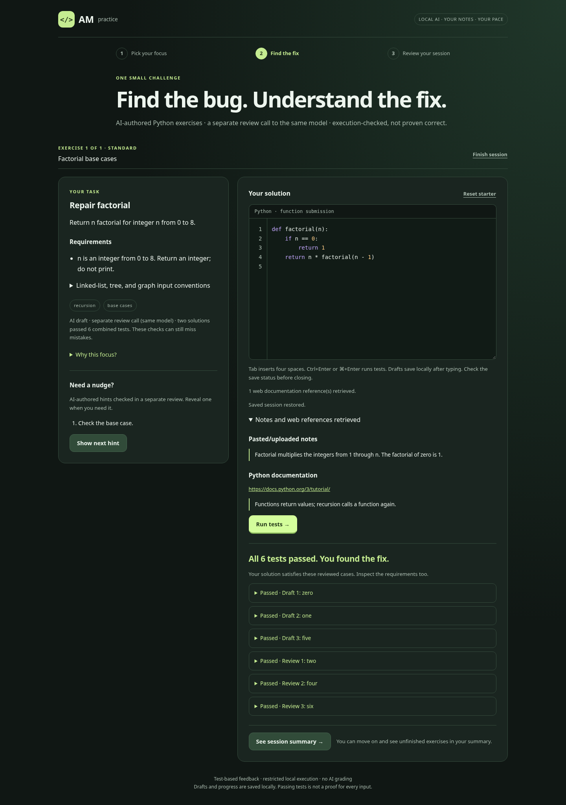

# AM · Coding practice

Turn your notes into short debugging sessions. Choose **Python, Java, C, or C++**,
fix a generated program, reveal hints, run tests, and review your session.
AM runs locally with Ollama and grades code using restricted Docker execution.

## Quick start

From the repository, with the existing model and runner images installed:

```bash
python am.py on --diagnostics
```

Open **http://127.0.0.1:8090**. Keep the terminal open. Start with one exercise.
Press **Ctrl+C** to stop, or use another terminal:

```bash
python am.py off
python am.py status
```

The launch terminal remains open while you study. Managed startup maintains
Docker authorization during normal use; [renewal after sleep](docs/docker-access.md)
happens there without restarting the app.

Stopping cancels active work, cleans up containers, and unloads the selected
models. Shared Ollama and Docker services remain available. Practice sessions
and editor drafts are saved locally in SQLite. Wait for the draft-save status
before closing. Resume unfinished sessions from the dashboard after restarting.
Stop any older `practice_web.py` launch before switching to the managed commands.

## Setup

Requirements: **Linux, Python 3.10+, Ollama, and Docker**. Application code uses
Python's standard library. The default model is `am-study:latest`, configured
from `gpt-oss:20b` with a 32,768-token context in
[`infrastructure/Modelfile`](infrastructure/Modelfile). Startup reports installed
model metadata. No models are downloaded automatically.

With `gpt-oss:20b` already installed, create the alias if missing:

```bash
ollama create am-study -f infrastructure/Modelfile
```

For first-time runner setup:

```bash
sudo systemctl start docker
sudo -v
python tools/check_runner_runtime.py --pin
python tools/setup_compiled_runtime.py
```

The Python image listed in `infrastructure/python-runner-image.txt` must be
available locally. See [runtime setup](docs/multilanguage-practice.md) for compiler
options and limits. Existing installations do not need a rebuild for frontend edits.

## Saved learning and notes

The dashboard shows saved sessions, a daily goal, real completion history/streaks,
learning-path topics, and due reviews. The editor has local syntax highlighting,
line numbers, indentation, and autosave. Export/delete controls manage the local
study profile in Git-ignored `.am-data/`.

Text/Markdown/code notes and text-based PDFs are accepted. Install Poppler for PDF
extraction (`sudo apt install poppler-utils`, or `sudo pacman -S poppler` on Arch).
Long notes use local passage retrieval and visible source references. No cloud
API, vector service, or additional AI model is required.



Screenshot from the controlled browser demo, using regression fixtures rather
than a live model. The production app always uses the AI preparation pipeline.

## Customize the app

| Change | Edit |
| --- | --- |
| Colors, fonts, spacing, mobile layout | [`web/app.css`](web/app.css) |
| Page headings, labels, buttons, structure | [`web/index.html`](web/index.html) |
| Dynamic session text, hints UI, results | [`web/app.js`](web/app.js) |
| Highlighting and editor behavior | [`web/editor.js`](web/editor.js) |
| Dashboard, paths, goals, review UI | [`web/study.js`](web/study.js) |
| Learning-path topic lists | [`learning_paths.py`](learning_paths.py) |
| AI instructions, review, repair | [`ai_exercises.py`](ai_exercises.py) |
| Supported function types | [`language_contracts.py`](language_contracts.py) |

Frontend changes need a browser refresh. Backend changes need an app restart.
The [project map](docs/project-map.md) explains every module and the request flow.

## How it works

The local model drafts a question, buggy starter, reference, hints, and tests.
A separate blind review derives another solution and test set. Both references
must pass the combined cases, and the starter must show a wrong answer without
crashing on the checked inputs. Student grading uses execution and comparisons;
AI does not decide whether a submission passed.

New requests ask for 3–5 small cases per call and use typed native contracts.
Failed drafts receive bounded repairs. Model agreement and passing tests are
useful evidence, not proof of correctness. No web search or embedding service is enabled. Long notes use bounded local
lexical retrieval before generation.
Bounded linked-list, tree, and graph inputs are supported across all four
languages; see the structured-input guide for calling conventions and limits.

Every practice session is AI-generated. There is no bundled question bank,
prewritten exercise generator, or offline/template fallback. Run tests and hints
only within a generated session. Fixed examples in `tests/` simulate model and
runner responses for regression checks; the app never serves them as questions.

`am.py chat` is optional terminal chat. Open WebUI remains independent of the
practice website.

## Guides

- [Docker authorization and all-day practice](docs/docker-access.md)
- [Desktop start/stop commands and independent Open WebUI](docs/desktop-commands.md)
- [Project map and editing guide](docs/project-map.md)
- [Saved learning and privacy](docs/saved-learning.md)
- [Structured inputs](docs/structured-inputs.md)
- [PDF notes and retrieval](docs/notes-and-retrieval.md)
- [Validation, demo, and live benchmark](docs/validation.md)
- [Release status and roadmap](docs/roadmap.md)
- [Generation, review, and accuracy limitations](docs/verification.md)
- [Java/C/C++ setup](docs/multilanguage-practice.md)
- [Open WebUI configuration](docs/open-webui.md)

## Development checks

```bash
python -m unittest discover -s tests -v
node --check web/app.js
node --check web/editor.js
node --check web/study.js
```

Default tests use controlled model/service fixtures. Optional real Docker checks
are documented in the runtime guides. Keep tests and validation tools with the
source: they protect the execution boundary and generation contracts.

Diagnostics save rejected drafts to Git-ignored `.am-diagnostics/`; inspect them
before sharing. Runtime pins and locks stay in `.am-runtime/`. Existing private
configuration, model storage, archived local files, and Open WebUI data are not
removed by repository cleanup.
