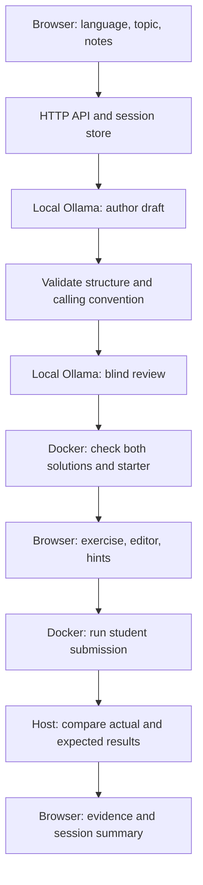

# Project map and editing guide

AM is a local web app with a plain HTML/CSS/JavaScript interface and a Python
backend. It has no frontend build step or external Python packages. Ollama runs
the installed model; Docker compiles and executes submissions.

## Where to edit the interface

| What you want to change | File and location |
| --- | --- |
| Colors, fonts, rounded corners, page width | `web/app.css`: variables in `:root` at the top |
| Header, setup page title, form labels, buttons, footer | `web/index.html` |
| Header logo mark | `web/index.html`: `.brand` and `.brand-mark` |
| Page layout and spacing | `web/app.css`: Page, Setup form, and Exercise workspace sections |
| Mobile layout | `web/app.css`: Small screens section at the bottom |
| Text that changes during a session | `web/app.js`: `renderSession`, `renderResults`, and `another-session` handler |
| Test-result labels and language display names | `web/app.js`: `labels` and `languageLabels` near the top |
| Sample notes | `web/app.js`: `sample` click handler |
| Setup mode explanation | `web/app.js`: `/api/setup` response handler at the bottom |
| Generation progress text | `ai_exercises.py`: calls to `self.progress` |
| Supported languages and setup metadata | `practice_planner.py`: `LANGUAGES`; `practice_web.py`: `/api/setup` |

Start the app with `python am.py on --diagnostics`. Edit a frontend file, save,
and refresh the browser. No rebuild is needed. Refreshing during a session can
lose your current editor state; finish the session before editing the UI.
Backend changes require stopping and restarting the app.

Keep existing HTML `id` values unless you update their matching JavaScript
selectors too. Edit generated content with `textContent`, as the app currently
does, so notes and model output are displayed as text rather than executed HTML.
The stylesheet comments are section markers, not generated code.

## Repository outline

```text
AM/
├── am.py                       Public on/off/status and model-only commands
├── site_control.py             Website ownership, model loading, clean shutdown
├── am_core.py                  Local Ollama HTTP client and model defaults
├── chat.py                     Optional terminal chat used by am.py chat
├── practice_web.py             Loopback HTTP server and browser API
├── practice_sessions.py        Session lifecycle, attempts, next, and summary
├── ai_exercises.py             AI author, blind review, repair, execution checks
├── language_contracts.py       Supported native types and function signatures
├── practice_planner.py         Input validation and explicit template planning
├── exercise_families.py        Reviewed Python templates for offline/template mode
├── generation_diagnostics.py   Optional local rejected-generation reports
├── code_runner.py              Container lifecycle and host-side result grading
├── compiled_runner.py          Java/C/C++ runner configuration
├── compiled_driver.py          Compile/run supervision inside the container
├── native_harness.py           Language-specific wrappers around solve(...)
├── run_submission.py           Lesson loading and optional command-line grading
├── web/
│   ├── index.html              Page structure and static text
│   ├── app.css                 Theme, components, responsive layout
│   └── app.js                  Browser state, API calls, hints, results, summary
├── exercises/python/
│   └── largest_value.json      Default lesson used by the API and regression checks
├── tools/
│   ├── setup_compiled_runtime.py  One-time Java/C/C++ compiler setup
│   ├── check_runner_runtime.py    Python runtime probe and image pinning
│   └── validate_lesson.py         Shared lesson validation and authoring CLI
├── infrastructure/
│   ├── Modelfile               am-study alias built from gpt-oss:20b
│   ├── python-runner-image.txt Pinned Python runtime image
│   ├── compiled-runtime/      Compiler image definitions
│   ├── compose.yaml           Existing Open WebUI and search-service configuration
│   └── searxng/settings.yml   Existing search-service configuration
├── tests/                      Regression checks and optional Docker integration
└── docs/                       Current setup, architecture, limits, roadmap
```

The old example lesson is still referenced by the server and tests. Template
modules are still used by `--offline` and `--templates`. Tests, image pins,
validators, and runtime setup tools are maintained parts of the application.
Existing search configuration is kept for the user's separate service; the
practice generator does not call it. Old milestone notes, duplicate example
submissions, the context benchmark tool, and the completed archive helper have
been removed. Git history retains those tracked files.

## What happens when you build a session



Invalid drafts receive bounded repair attempts. Unresolved failures stop
preparation; they never silently become another topic or a template exercise.
The reviewer receives the task and notes, not the author's reference or tests.

## Runtime data outside Git

- `.am-runtime/`: compiler pin, website ownership record, and lock.
- `.am-diagnostics/`: rejected generation reports when diagnostics are enabled.
- `.am-archive/`: existing local backups from the earlier cleanup.
- `infrastructure/.env.openwebui`: private service configuration.

These are machine-specific or private. This cleanup leaves them alone. Models
live in Ollama storage; Open WebUI chats live in its Docker volume. The practice
app currently keeps notes, attempts, and editor drafts in memory.
